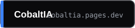
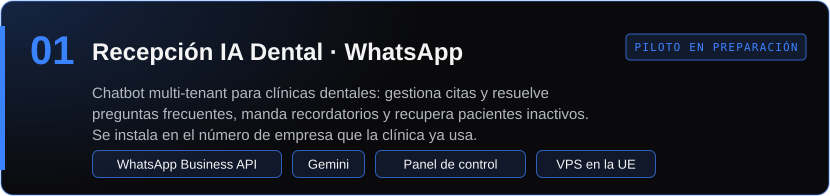
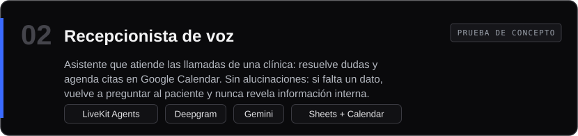
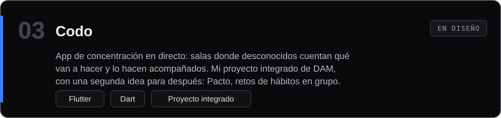
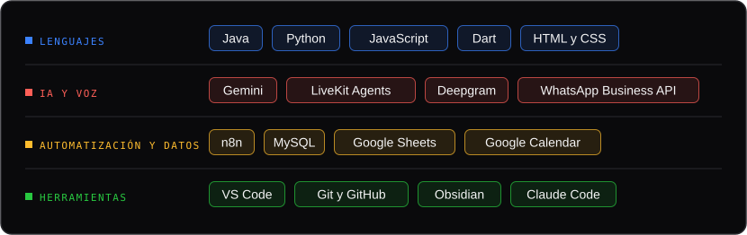
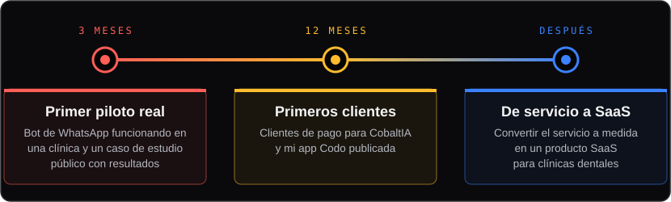

 

Tengo 19 años, estudio 2º de **Desarrollo de Aplicaciones Multiplataforma** y construyo **recepcionistas con IA para clínicas dentales**: asistentes que atienden a los pacientes por WhatsApp y por teléfono. Lo hago con **[CobaltIA](https://cobaltia.pages.dev)**, nuestra agencia de IA, y a la vez desarrollo mi propia app en Flutter.

Aquí documento lo que construyo, lo que aprendo por el camino y hacia dónde voy.

&nbsp;&nbsp;

 

## Lo que estoy construyendo

 

 

 

## Con lo que construyo

 

## Hacia dónde voy

 

## Actividad

 

